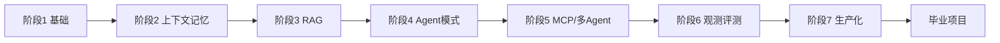

# leetagent —— 像刷 LeetCode 一样，从后端工程师转型 Agent 工程师（Go）

leetagent 是一套面向**后端工程师**的 Agent 工程练习题：**7 个阶段 + 1 个毕业项目，共 34 道题**。
从工具注册表、重试、上下文管理，到 RAG、ReAct 循环、MCP、多 Agent、可观测性、评测和生产化，每道题都有题目、骨架代码、测试、3 级提示和参考答案。

- **语言**：Go（1.26+），只用标准库 + 少量依赖（纯 Go SQLite）。
- **离线友好**：测试只用 mock LLM / `httptest`，不需要 API Key，也不需要联网（`go mod download` 之后）。
- **判题器就是 `go test`**：测试全绿 = AC。这和真实工程的工作方式一致。

## 快速开始

```bash
git clone <this-repo> leetagent && cd leetagent
go mod download                                  # 只需联网这一次；也可以 go mod vendor 后彻底离线
go test ./stage1_foundation/ex01_registry/       # 第一题：现在会 FAIL，这是正常的
# 打开 stage1_foundation/README.md 和 stage1_foundation/ex01_registry/README.md 开始做题
go test -tags solution ./...                     # 验证环境：参考答案应全部 ok
```

建议先 fork 一份到自己账号，在自己的分支上做题；想恢复某题初始骨架用 `git checkout -- <路径>/exercise.go`。

## 目录



| 阶段 | 目录 | 题数 | 建议用时 |
|---|---|---|---|
| 1 | [stage1_foundation](stage1_foundation/README.md) Go 工程 × LLM 调用 | 5 | 5~7 天 |
| 2 | [stage2_context_memory](stage2_context_memory/README.md) 上下文与记忆 | 4 | 5~7 天 |
| 3 | [stage3_rag](stage3_rag/README.md) 检索增强 | 5 | 7~10 天 |
| 4 | [stage4_agent_patterns](stage4_agent_patterns/README.md) Agent 核心模式 | 5 | 7~10 天 |
| 5 | [stage5_mcp_multiagent](stage5_mcp_multiagent/README.md) MCP 与多 Agent | 4 | 7~10 天 |
| 6 | [stage6_observability_eval](stage6_observability_eval/README.md) 可观测性与评测 | 4 | 5~7 天 |
| 7 | [stage7_production](stage7_production/README.md) 生产化 | 4 | 5~7 天 |
| ★ | [capstone](capstone/README.md) 论坛研究 Agent | 3 | 5~7 天 |

`common/` 是全课程共用的类型、流式 LLM 客户端和 mock 服务器，**不用改**，但值得读。

## 每道题的文件

```
exXX_name/
├── README.md          题目、背景、要求、坑
├── exercise.go        你要写的代码（TODO）
├── exercise_test.go   表驱动测试 —— 判题标准，别改
├── HINTS.md           3 级提示：卡住 20 分钟看第 1 条，再卡看第 2 条……
├── solution/          参考答案
└── link_solution.go   让 -tags solution 时测试跑参考答案（不用管）
```

## 常用命令（都在仓库根目录执行）

```bash
go test ./stage1_foundation/ex01_registry/          # 测一道题
go test -v -run TestRegister ./stage1_foundation/ex01_registry/   # 只跑某个用例，看详细输出
go test ./stage1_foundation/...                     # 测整个阶段
go test -race ./stage4_agent_patterns/ex03_parallel_tools/        # 并发题加 -race
go test -timeout 30s ./...                          # 全部（没做的题会 FAIL）
go test -tags solution ./...                        # 跑参考答案（应全部 ok）
go vet ./... && gofmt -l .                          # 代码检查，gofmt 无输出才算干净
gofmt -w stage1_foundation/ex01_registry/exercise.go   # 自动格式化
```

测试卡住不动？多半是 channel 阻塞或死循环，`Ctrl+C` 后加 `-timeout 10s` 再跑，看 panic 里的 goroutine 栈。

## 什么时候看答案（偷看规则）

1. 先自己做 **至少 30 分钟**。
2. 卡住 → `HINTS.md` 第 1 条 → 再做 15 分钟 → 第 2 条 → 第 3 条。
3. 第 3 条提示后仍做不出 → 看 `solution/`，**然后删掉你的代码，凭记忆重写一遍**直到测试通过。
4. 做出来了也要看 `solution/`，对比差异，这是学习最快的一步。

想恢复某道题的初始骨架：`git checkout -- stage1_foundation/ex01_registry/exercise.go`。

**剧透政策**：`solution/` 只在 `-tags solution` 下参与编译，默认 `go test` 跑的是你自己的代码。请不要把你的答案以 PR 形式提交到 `exercise.go`——骨架必须保持 TODO 状态。

## 进度清单

阶段 1
- [ ] ex01_registry　- [ ] ex02_model_whitelist　- [ ] ex03_retry_backoff　- [ ] ex04_truncate　- [ ] ex05_slog

阶段 2
- [ ] ex01_session_store　- [ ] ex02_token_budget　- [ ] ex03_summary_compress　- [ ] ex04_long_term_memory

阶段 3
- [ ] ex01_cosine　- [ ] ex02_chunking　- [ ] ex03_vector_index　- [ ] ex04_search_tool　- [ ] ex05_hybrid_rrf

阶段 4
- [ ] ex01_react_loop　- [ ] ex02_json_schema　- [ ] ex03_parallel_tools　- [ ] ex04_approval_gate　- [ ] ex05_prompt_template

阶段 5
- [ ] ex01_mcp_server　- [ ] ex02_mcp_client　- [ ] ex03_subagent　- [ ] ex04_router

阶段 6
- [ ] ex01_trace　- [ ] ex02_eval_runner　- [ ] ex03_llm_judge　- [ ] ex04_cost_latency

阶段 7
- [ ] ex01_injection_guard　- [ ] ex02_rate_limiter　- [ ] ex03_sse_heartbeat_fallback　- [ ] ex04_deploy_health

毕业项目
- [ ] m1_forum_tools　- [ ] m2_research_index　- [ ] m3_research_agent

## 连接真模型（可选）

所有测试默认离线。想验证 `common.Client` 能连上任意 OpenAI 兼容服务（本地 vLLM / Ollama / 云端皆可）：

```bash
LEETAGENT_LIVE=1 go test -run TestLiveLLM -v ./common/
# 可选：LEETAGENT_BASE_URL=http://localhost:8000/v1 LEETAGENT_MODEL=<模型名>
```

连不上也不影响做题。

## （可选）用本地 LLM 当"学习搭子"的提问模板

可以用 curl 直接问（把 `<模型名>` 换成 `curl http://localhost:8000/v1/models` 里看到的名字）：

```bash
curl -s http://localhost:8000/v1/chat/completions -H 'Content-Type: application/json' -d '{
  "model": "<模型名>",
  "messages": [{"role":"user","content":"用中文解释 Go 的 context.WithTimeout，给 15 行例子"}]
}'
```

**1. 解释概念**
```
你是 Go 语言和 LLM Agent 的老师。请用中文解释「<概念>」，
给一个不超过 20 行、只用标准库的 Go 例子，最后用一句话总结。
```

**2. 测试失败，帮我找原因（不要答案）**
```
这是一道 Go 练习。题目要求（来自注释）：
<粘贴 exercise.go 中函数上方的注释>
我的实现：
<粘贴函数>
测试输出：
<粘贴 go test 的失败信息>
请指出最可能出错的一处和原因。不要给完整代码。
```

**3. 解释编译错误**
```
Go 编译报错：<粘贴错误>
相关代码：<粘贴 10 行左右>
这个错误是什么意思？怎么改？
```

**4. 代码审查**
```
请从边界条件、错误处理、并发安全三个角度审查这段 Go 代码，每个问题一句话：
<代码>
```

**5. 对比参考答案**
```
下面是同一道题的两种实现。请用中文说明它们的区别，以及参考答案好在哪里：
我的：<代码>
参考：<代码>
```

**使用本地小模型的注意事项**
- 小模型**经常犯错、会编造不存在的 API**。它是"会查字典的同学"，不是老师；测试结果才是唯一的真相。
- 一次只问一个小问题，贴的代码越少越好（小模型上下文短）。
- 它给的函数名、包名，先用 `go doc <包>.<函数>` 验证是否存在（离线可用）。
- 它说"测试写错了"——几乎一定是它错了。

## 离线查文档

```bash
go doc context.WithTimeout
go doc -all log/slog | less
go doc net/http/httptest.NewRecorder
```

## 做完之后

每个阶段的 README 都写了"对应真实项目的哪部分"。把练习里的代码搬进你自己的 Agent 项目，就是真正的项目迭代。

## 路线图

- [ ] `leetagent` CLI：`leetagent test stage1/ex01`、本地进度 `progress.json`、下一题提示（底层仍是 `go test`）
- [ ] CI：只跑 `go test -tags solution ./...`，保证题面不坏
- [ ] Dev Container / Codespaces 一键环境
