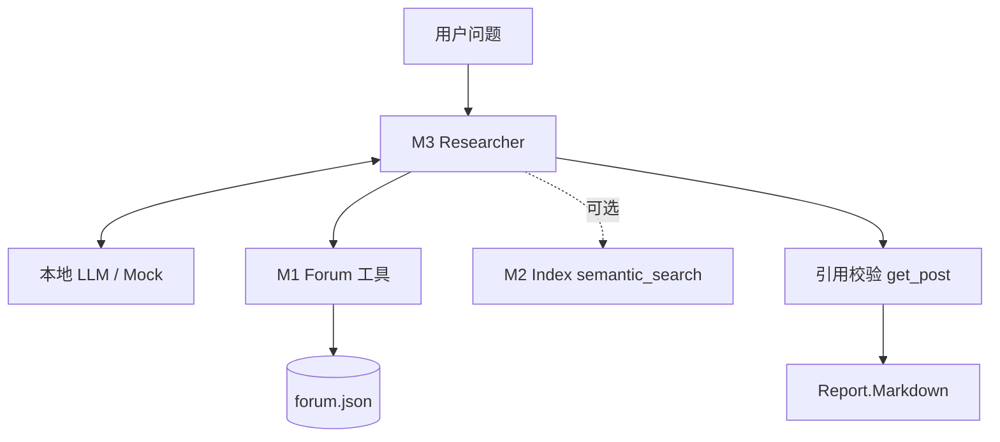
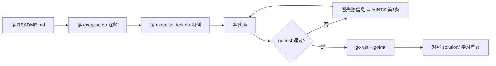

# 毕业项目：论坛研究 Agent

> 建议用时：5~7 天　|　练习数：3　|　对应真实项目：一个完整的 Agent 应用：server/agent + server/tools + web 的研究页面

## 学完你能做到

- [ ] 把论坛数据做成三个工具（M1）
- [ ] 做一个不依赖任何外部服务的检索索引（M2）
- [ ] 组装成会引用来源、能检测编造引用的研究 Agent（M3）
- [ ] （可选）连上 本地 LLM 真模型跑一遍，写评测集

## 全景图



## 项目说明

这是对前 7 个阶段的综合运用，也是 你的 Agent 项目 核心能力的离线"缩小版"：

| 里程碑 | 用到的阶段 | 产出 |
|---|---|---|
| M1 forum_tools | 阶段 1（工具注册）、阶段 3（search 工具） | `ToolRunner` + 3 个工具定义 |
| M2 research_index | 阶段 3（embedding、去重、Top-K） | 离线哈希向量索引 |
| M3 research_agent | 阶段 4（ReAct）、阶段 6/7（防幻觉思想） | 带引用校验的研究报告 |

三个里程碑**相互独立**：M3 的测试用的是 M1 的参考实现，所以你可以按任意顺序做。

### 做完之后（强烈建议）
1. 写一个 `cmd/research/main.go`：`common.NewClient("http://localhost:8000/v1")` + M1 Forum + M3 Researcher，命令行输入问题输出 Markdown。
2. 把 M2 的索引包装成第 4 个工具 `semantic_search`，对比只用 search_posts 的效果。
3. 用阶段 6 的 eval runner 写 10 条用例，统计"引用全部可验证"的比例。
4. 把阶段 7 的 GuardedRunner 套在 Forum 外面，在 forum.json 里加一条注入帖子试试。

## 练习清单

| # | 目录 | 题目 | 完成 |
|---|---|---|---|
| 1 | [`m1_forum_tools`](./m1_forum_tools/) | M1 论坛工具（毕业项目第 1 步） | ☐ |
| 2 | [`m2_research_index`](./m2_research_index/) | M2 研究索引（毕业项目第 2 步） | ☐ |
| 3 | [`m3_research_agent`](./m3_research_agent/) | M3 研究 Agent（毕业项目第 3 步） | ☐ |

## 每道题的做法



命令（在仓库根目录下）：

```bash
go test ./capstone/m1_forum_tools/            # 测你的代码
go test ./capstone/m2_research_index/            # 测你的代码
go test ./capstone/m3_research_agent/            # 测你的代码
go test -tags solution ./capstone/...   # 看参考答案是否通过
go test -run TestXxx -v ./<目录>/      # 只跑某个用例并看详细输出
```

## 常见坑

1. M3 测试依赖 `../m1_forum_tools/testdata/forum.json`，别删。
2. 真模型经常编造 tid——这正是引用校验的意义。
3. 小模型可能一次不调工具就回答，System prompt 要写清楚"必须先查"。
4. 做真机演练时别把 本地 LLM 的地址硬编码进测试，用环境变量。

## 自测问题（不看代码能回答出来才算掌握）

- **M1 论坛工具（毕业项目第 1 步）**：这道题解决了真实 Agent 里的什么问题？如果不做会出什么事故？
- **M2 研究索引（毕业项目第 2 步）**：这道题解决了真实 Agent 里的什么问题？如果不做会出什么事故？
- **M3 研究 Agent（毕业项目第 3 步）**：这道题解决了真实 Agent 里的什么问题？如果不做会出什么事故？
- 本阶段哪一个知识点最容易在 你的 Agent 项目 里落地？写下你打算改哪个文件。

## 卡住时：给本地 LLM 的提问模板

> ⚠️ 本地小模型，**会犯错、会编 API**。它的答案只是线索，`go test` 的结果才是真相。

**解释概念**
```
你是 Go 和 LLM Agent 方面的老师。用中文、举一个 20 行以内的 Go 例子，解释：<概念>。
不要使用第三方库。
```

**看不懂测试失败**
```
这是一个 Go 练习。题目要求：
<粘贴 exercise.go 里的注释>
我的代码：
<粘贴你的函数>
go test 输出：
<粘贴失败信息>
请只指出哪一行逻辑有问题以及原因，不要直接给完整答案。
```

**代码审查**
```
请审查下面的 Go 代码，只关注：边界条件、并发安全、错误处理。列出问题，每条一句话。
<代码>
```

## 学习笔记

在这里记下你的心得（这个文件是你的，随便改）：

1. 
2. 
3. 
4. 
5. 
6. 
7. 
8. 
9. 
10. 
11. 
12. 
13. 
14. 
15. 
16. 
17. 
18. 
19. 
20. 
21. 
22. 

## 完成标准

- [ ] `go test ./capstone/...` 全部 ok
- [ ] `go vet ./capstone/...` 无输出
- [ ] `gofmt -l capstone` 无输出
- [ ] 每道题都对照过 solution/，记下至少一个"原来还可以这样写"
- [ ] 回答完上面的自测问题

下一步：回到 [课程首页](../README.md) 勾选进度。
