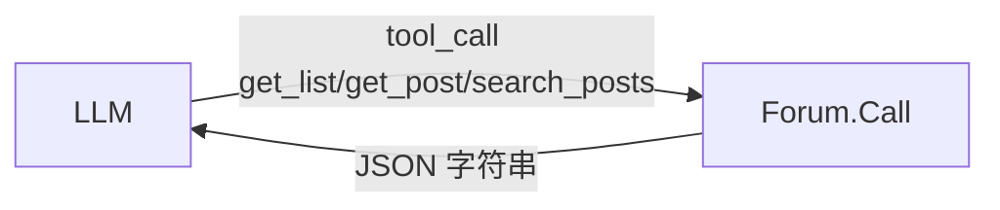

# M1 论坛工具（毕业项目第 1 步）

把 `testdata/forum.json` 包装成三个工具，实现 `common.ToolRunner`。这就是 你的 Agent 项目 里论坛工具的离线版本。

要求见 exercise.go。

## 坑
- 列表只返回摘要，不返回正文：省上下文，让模型需要时再 get_post。
- 空切片 `json.Marshal` 出来是 `null`，要用 `[]Summary{}` 初始化。
- 工具描述写给**小模型**看，要具体（"按帖子编号 tid 读取完整正文"），不要只写 "get post"。

验收：`go test ./capstone/m1_forum_tools/`
