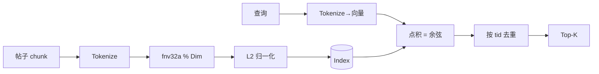

# M2 研究索引（毕业项目第 2 步）

旅行中可能连不上 embedding 模型，所以用**特征哈希（hashing trick）**做一个纯本地的"假 embedding"：
中文用二字 bigram、英文用单词，哈希到固定维度后 L2 归一化。效果接近关键词检索，但接口和真 embedding 一模一样——以后把 HashEmbedder 换成调用 `/v1/embeddings` 即可。

## 坑
- 同一帖子多个 chunk 都命中，如果不去重，Top-5 可能全是同一帖子。
- 哈希冲突会带来少量假阳性，Dim 越大越少（256~4096 都行）。
- 中文单字粒度太粗（"的"到处都是），bigram 是简单有效的折中。

验收：`go test ./capstone/m2_research_index/`
