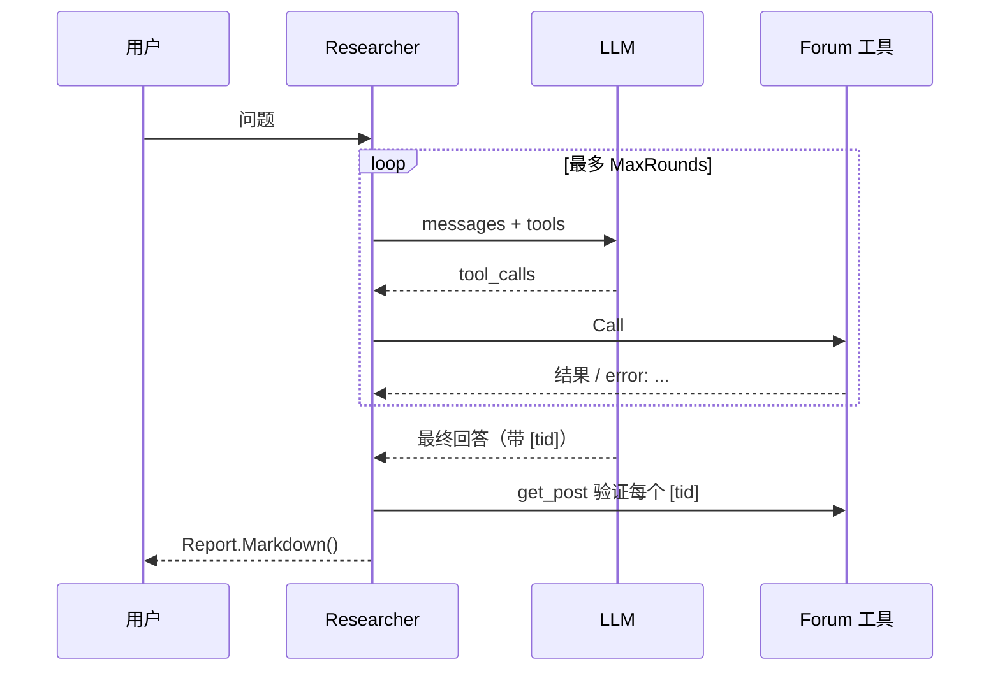

# M3 研究 Agent（毕业项目第 3 步）

把前面所有阶段串起来：ReAct 循环（阶段 4）+ 论坛工具（M1）+ 引用校验（防幻觉，阶段 6/7 的思想）。

## 坑
- 工具出错不要中断循环，把 `error: ...` 交给模型——小模型经常第一次参数写错。
- 每个 tool 消息的 ToolCallID 必须对应，否则 OpenAI 兼容服务会 400。
- **引用校验是最便宜的防幻觉手段**：本地 LLM 这类小模型很爱编造帖子编号。

## 真机演练（可选，需要能连 本地 LLM）
用 `common.NewClient("http://localhost:8000/v1")` 当 LLM，`m1` 的 Forum 当工具，写个 main 跑一下，看看小模型会不会编造引用。
测试里不要连真模型——见顶层 README 的 `LEETAGENT_LIVE=1`。

验收：`go test ./capstone/m3_research_agent/`
