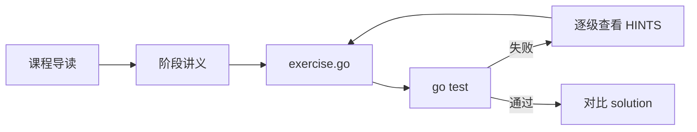

# leetagent 课程目录

这套课程面向已经会 Go、HTTP、数据库和基本后端开发，希望系统学习 Agent 工程的开发者。课程不是单独的视频或理论文章，而是“课程导读 + 阶段讲义 + 可运行练习”的组合。

## 如何使用

每一课按下面的顺序完成：

1. 阅读 `course/` 中的课程导读，建立这一阶段的整体模型。
2. 阅读对应阶段的 `README.md`，学习核心概念、工程取舍和常见坑。
3. 在浏览器或 IDE 中完成配套练习，以 `go test` 作为验收标准。
4. 测试通过后再阅读 `solution/`，对比实现差异。

## 学习路线

| 课程 | 主题 | 练习数 | 建议用时 | 完成后能够 |
|---|---|---:|---:|---|
| [第 1 课](01-foundation.md) | Go 工程基础 × LLM 调用 | 5 | 5~7 天 | 构建可靠的 LLM 客户端与工具层 |
| [第 2 课](02-context-memory.md) | 上下文与记忆 | 4 | 5~7 天 | 管理会话、Token 预算和长期记忆 |
| [第 3 课](03-rag.md) | RAG 检索增强 | 5 | 7~10 天 | 实现切块、向量检索和混合检索 |
| [第 4 课](04-agent-patterns.md) | Agent 核心模式 | 5 | 7~10 天 | 实现 ReAct、结构化输出和审批闸门 |
| [第 5 课](05-mcp-multiagent.md) | MCP 与多 Agent | 4 | 7~10 天 | 实现 MCP、子 Agent 和任务路由 |
| [第 6 课](06-observability-eval.md) | 可观测性与评测 | 4 | 5~7 天 | 建立 Trace、评测集和成本指标 |
| [第 7 课](07-production.md) | 生产化 | 4 | 5~7 天 | 处理安全、限流、降级和部署 |
| [毕业项目](08-capstone.md) | 论坛研究 Agent | 3 | 5~7 天 | 组装一个可验证引用的完整 Agent |

共 34 道练习。建议按顺序学习；如果已经有 Agent 开发经验，也可以直接从薄弱阶段开始。

## 目录职责

- `course/`：课程路线、每课目标、先修知识和学习顺序。
- `stage*/README.md`：详细讲义、全景图、核心概念与常见坑。
- `stage*/ex*/`：题目、代码骨架、测试、提示和参考答案。
- `capstone/`：综合项目。

[返回项目首页](../README.md)
