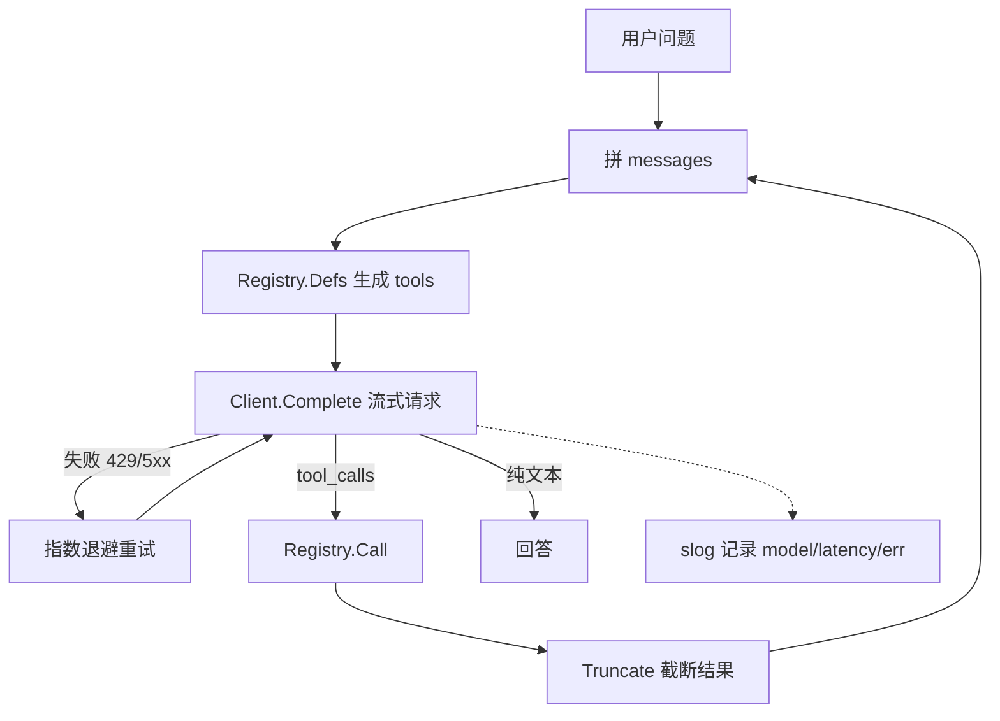
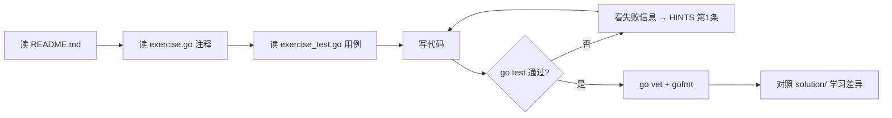

# 阶段 1：Go 工程基础 × LLM 调用

> 建议用时：5~7 天　|　练习数：5　|　对应真实项目：server/llm（客户端、重试）、server/tools（注册表）、server/main.go（日志）

## 学完你能做到

- [ ] 掌握 OpenAI 兼容接口的请求/响应结构（messages、tools、tool_calls）
- [ ] 用 interface + map 写出可扩展的工具注册表
- [ ] 用 context 控制超时与取消，写出带指数退避的重试
- [ ] 理解为什么工具结果要截断（上下文窗口是稀缺资源）
- [ ] 用 log/slog 打结构化日志，日志里永远不出现密钥

## 全景图



## 核心概念

### 1. 一次 Chat Completion 到底发生了什么
LLM 本身是**无状态**的：每次请求都要把完整的 messages 发过去。Agent 的"记忆""工具"其实都是**你在客户端拼 messages**。

```json
{"model":"qwen","messages":[{"role":"system","content":"..."},{"role":"user","content":"..."}],
 "tools":[{"type":"function","function":{"name":"get_post","parameters":{...}}}],"stream":true}
```

模型想调工具时，返回的 assistant 消息里有 `tool_calls`；你执行后追加 `role=tool` 的消息（`tool_call_id` 对上），再请求一次。

### 2. 流式（SSE）与 tool_calls 分片
`stream:true` 时，服务端一行一行推 `data: {...}`。文本在 `delta.content`；工具调用的 `arguments` 会被**切成很多片**，必须按 `index` 拼接。`common/client.go` 已经实现了，建议通读一遍——它就是 你的 Agent 项目 `server/llm` 的精简版。

### 3. context.Context
- `ctx` 是"这次请求的生命线"：用户关掉页面 → ctx 取消 → 所有下游调用都应尽快返回。
- 重试的等待也要 `select { case <-ctx.Done(): case <-time.After(d): }`，否则取消后还傻等。

### 4. 错误分类
| 错误 | 要不要重试 |
|---|---|
| 429 / 5xx / 网络超时 | 要（退避） |
| 400 / 401 / 404 | 不要（重试也一样错） |
| ctx 已取消 | 绝对不要 |

## 练习清单

| # | 目录 | 题目 | 完成 |
|---|---|---|---|
| 1 | [`ex01_registry`](./ex01_registry/) | ex01 工具 Registry（Easy） | ☐ |
| 2 | [`ex02_model_whitelist`](./ex02_model_whitelist/) | ex02 模型白名单 + 默认值（Easy） | ☐ |
| 3 | [`ex03_retry_backoff`](./ex03_retry_backoff/) | ex03 超时、取消与指数退避重试（Medium） | ☐ |
| 4 | [`ex04_truncate`](./ex04_truncate/) | ex04 工具结果截断（Easy） | ☐ |
| 5 | [`ex05_slog`](./ex05_slog/) | ex05 结构化日志 slog（Easy） | ☐ |

## 每道题的做法



命令（在仓库根目录下）：

```bash
go test ./stage1_foundation/ex01_registry/            # 测你的代码
go test ./stage1_foundation/ex02_model_whitelist/            # 测你的代码
go test ./stage1_foundation/ex03_retry_backoff/            # 测你的代码
go test ./stage1_foundation/ex04_truncate/            # 测你的代码
go test ./stage1_foundation/ex05_slog/            # 测你的代码
go test -tags solution ./stage1_foundation/...   # 看参考答案是否通过
go test -run TestXxx -v ./<目录>/      # 只跑某个用例并看详细输出
```

## 常见坑

1. 忘了 `defer resp.Body.Close()` → 连接泄漏，跑久了 too many open files。
2. `json.RawMessage` 的 Parameters 不合法时，服务端返回 400，错误信息很隐晦；用 `json.Valid` 先检查。
3. 退避时间要有上限（cap），并加抖动（jitter），否则多个客户端同时重试会再次压垮服务。
4. 截断中文要按 rune 截，按字节截会切出乱码 `\ufffd`。
5. slog 里别 `slog.Any("req", req)` 整个打出来——里面可能有 API Key。

## 自测问题（不看代码能回答出来才算掌握）

- **ex01 工具 Registry（Easy）**：这道题解决了真实 Agent 里的什么问题？如果不做会出什么事故？
- **ex02 模型白名单 + 默认值（Easy）**：这道题解决了真实 Agent 里的什么问题？如果不做会出什么事故？
- **ex03 超时、取消与指数退避重试（Medium）**：这道题解决了真实 Agent 里的什么问题？如果不做会出什么事故？
- **ex04 工具结果截断（Easy）**：这道题解决了真实 Agent 里的什么问题？如果不做会出什么事故？
- **ex05 结构化日志 slog（Easy）**：这道题解决了真实 Agent 里的什么问题？如果不做会出什么事故？
- 本阶段哪一个知识点最容易在 你的 Agent 项目 里落地？写下你打算改哪个文件。

## 卡住时：给本地 LLM 的提问模板

> ⚠️ 本地小模型，**会犯错、会编 API**。它的答案只是线索，`go test` 的结果才是真相。

**解释概念**
```
你是 Go 和 LLM Agent 方面的老师。用中文、举一个 20 行以内的 Go 例子，解释：<概念>。
不要使用第三方库。
```

**看不懂测试失败**
```
这是一个 Go 练习。题目要求：
<粘贴 exercise.go 里的注释>
我的代码：
<粘贴你的函数>
go test 输出：
<粘贴失败信息>
请只指出哪一行逻辑有问题以及原因，不要直接给完整答案。
```

**代码审查**
```
请审查下面的 Go 代码，只关注：边界条件、并发安全、错误处理。列出问题，每条一句话。
<代码>
```

## 学习笔记

在这里记下你的心得（这个文件是你的，随便改）：

1. 
2. 
3. 
4. 
5. 
6. 
7. 
8. 
9. 
10. 
11. 
12. 
13. 
14. 
15. 
16. 
17. 
18. 
19. 
20. 
21. 
22. 

## 完成标准

- [ ] `go test ./stage1_foundation/...` 全部 ok
- [ ] `go vet ./stage1_foundation/...` 无输出
- [ ] `gofmt -l stage1_foundation` 无输出
- [ ] 每道题都对照过 solution/，记下至少一个"原来还可以这样写"
- [ ] 回答完上面的自测问题

下一步：回到 [课程首页](../README.md) 勾选进度。
