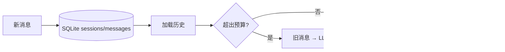
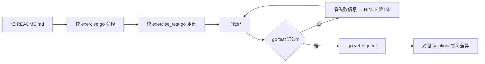

# 阶段 2：上下文与记忆

> 建议用时：5~7 天　|　练习数：4　|　对应真实项目：server/store（SQLite）、server/agent（历史加载）

## 学完你能做到

- [ ] 用 SQLite 持久化会话（离线、单文件、零运维）
- [ ] 估算 token 并在预算内裁剪历史，保证 system 和最新消息不丢
- [ ] 用 LLM 把旧对话压缩成摘要
- [ ] 实现跨会话的长期记忆：写入、检索、去重、遗忘

## 全景图



## 核心概念

### 1. 上下文窗口 = 工作记忆
小模型（如 本地 LLM）上下文常见 8K~32K token。历史、工具结果、检索资料都在抢这块空间。**上下文管理是 Agent 工程师的日常。**

### 2. 三层记忆
| 层 | 存什么 | 生命周期 | 本阶段练习 |
|---|---|---|---|
| 工作记忆 | 当前 messages | 一次请求 | ex02 预算裁剪 |
| 会话记忆 | 本会话全部消息 / 摘要 | 一个会话 | ex01、ex03 |
| 长期记忆 | 用户偏好、事实 | 跨会话 | ex04 |

### 3. Token 估算
没有 tokenizer 时用经验值：英文约 4 字符 / token，中文约 1~1.5 字 / token。估算宁可**偏大**，超窗口的代价是请求直接 400。

### 4. 摘要压缩的时机
- 超过阈值（如预算 70%）才压缩，别每轮都压（贵且慢）。
- 摘要作为一条 system 消息放在最前面，原始旧消息可以留在数据库里备查。
- 摘要也可能出错——关键事实（订单号、文件名）最好结构化存储而不是只靠摘要。

## 练习清单

| # | 目录 | 题目 | 完成 |
|---|---|---|---|
| 1 | [`ex01_session_store`](./ex01_session_store/) | ex01 SQLite 会话持久化（Medium） | ☐ |
| 2 | [`ex02_token_budget`](./ex02_token_budget/) | ex02 Token 估算与预算裁剪（Medium） | ☐ |
| 3 | [`ex03_summary_compress`](./ex03_summary_compress/) | ex03 对话摘要压缩（Medium） | ☐ |
| 4 | [`ex04_long_term_memory`](./ex04_long_term_memory/) | ex04 长期记忆（Medium） | ☐ |

## 每道题的做法



命令（在仓库根目录下）：

```bash
go test ./stage2_context_memory/ex01_session_store/            # 测你的代码
go test ./stage2_context_memory/ex02_token_budget/            # 测你的代码
go test ./stage2_context_memory/ex03_summary_compress/            # 测你的代码
go test ./stage2_context_memory/ex04_long_term_memory/            # 测你的代码
go test -tags solution ./stage2_context_memory/...   # 看参考答案是否通过
go test -run TestXxx -v ./<目录>/      # 只跑某个用例并看详细输出
```

## 常见坑

1. SQLite 并发写会 `database is locked`：开启 WAL，或者 `SetMaxOpenConns(1)`。
2. 裁剪时把 assistant 的 tool_calls 和对应的 tool 消息**拆开**了 → 服务端 400。要成对保留或成对丢弃。
3. 摘要提示词里要说明"保留人名、数字、结论"，否则小模型会写成空话。
4. 长期记忆不去重会越存越多，检索结果全是重复条目。
5. 测试里用 `:memory:` 或 `t.TempDir()`，别污染真实数据库。

## 自测问题（不看代码能回答出来才算掌握）

- **ex01 SQLite 会话持久化（Medium）**：这道题解决了真实 Agent 里的什么问题？如果不做会出什么事故？
- **ex02 Token 估算与预算裁剪（Medium）**：这道题解决了真实 Agent 里的什么问题？如果不做会出什么事故？
- **ex03 对话摘要压缩（Medium）**：这道题解决了真实 Agent 里的什么问题？如果不做会出什么事故？
- **ex04 长期记忆（Medium）**：这道题解决了真实 Agent 里的什么问题？如果不做会出什么事故？
- 本阶段哪一个知识点最容易在 你的 Agent 项目 里落地？写下你打算改哪个文件。

## 卡住时：给本地 LLM 的提问模板

> ⚠️ 本地小模型，**会犯错、会编 API**。它的答案只是线索，`go test` 的结果才是真相。

**解释概念**
```
你是 Go 和 LLM Agent 方面的老师。用中文、举一个 20 行以内的 Go 例子，解释：<概念>。
不要使用第三方库。
```

**看不懂测试失败**
```
这是一个 Go 练习。题目要求：
<粘贴 exercise.go 里的注释>
我的代码：
<粘贴你的函数>
go test 输出：
<粘贴失败信息>
请只指出哪一行逻辑有问题以及原因，不要直接给完整答案。
```

**代码审查**
```
请审查下面的 Go 代码，只关注：边界条件、并发安全、错误处理。列出问题，每条一句话。
<代码>
```

## 学习笔记

在这里记下你的心得（这个文件是你的，随便改）：

1. 
2. 
3. 
4. 
5. 
6. 
7. 
8. 
9. 
10. 
11. 
12. 
13. 
14. 
15. 
16. 
17. 
18. 
19. 
20. 
21. 
22. 

## 完成标准

- [ ] `go test ./stage2_context_memory/...` 全部 ok
- [ ] `go vet ./stage2_context_memory/...` 无输出
- [ ] `gofmt -l stage2_context_memory` 无输出
- [ ] 每道题都对照过 solution/，记下至少一个"原来还可以这样写"
- [ ] 回答完上面的自测问题

下一步：回到 [课程首页](../README.md) 勾选进度。
