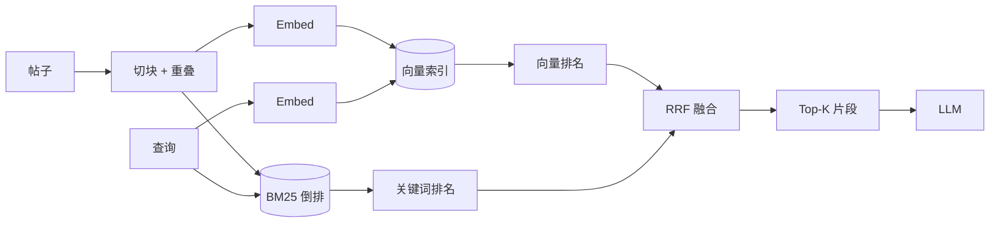
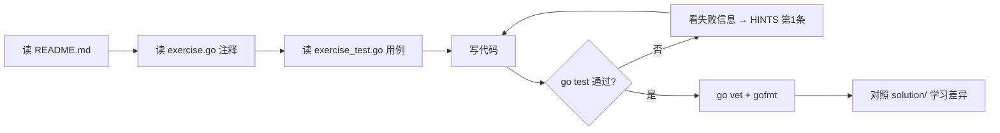

# 阶段 3：RAG 检索增强

> 建议用时：7~10 天　|　练习数：5　|　对应真实项目：server/tools 里的 search_posts、server/rag（如果你后面加）

## 学完你能做到

- [ ] 理解 embedding 与余弦相似度
- [ ] 把长文切块，并用重叠避免切断语义
- [ ] 实现内存向量索引和 Top-K
- [ ] 把检索包装成 Agent 工具
- [ ] 用 BM25 + 向量 + RRF 做混合检索

## 全景图



## 核心概念

### 1. 为什么要 RAG
模型不知道你论坛里的帖子。RAG = 先**检索**相关片段，再塞进 prompt 让模型**基于资料回答**。比微调便宜、可更新、可引用来源。

### 2. 向量检索
- embedding：文本 → 固定长度向量，语义近的向量夹角小。
- 余弦相似度 = 点积 / (|a|·|b|)；向量提前归一化后就是点积。
- 小数据量（< 10 万条）直接暴力扫描足够快，不必上向量数据库。

### 3. 切块（Chunking）
| 块太大 | 块太小 |
|---|---|
| 噪音多、占上下文 | 语义被切碎、缺上下文 |
常见：300~800 字一块，重叠 10%~20%。

### 4. 关键词 vs 语义
- BM25 擅长精确词（错误码、函数名、人名）。
- 向量擅长同义改写（"内存泄漏" ≈ "goroutine 没退出"）。
- **RRF**：`score = Σ 1/(k + rank)`，只看名次不看分数，免去两种分数量纲不一致的问题，k 常取 60。

### 5. 检索作为工具 vs 每轮自动检索
- 自动检索：简单，但每轮都花 token。
- 作为工具：模型自己决定何时搜、搜什么——更 Agentic，但小模型可能不搜。你的 Agent 项目 用的是工具方式。

## 练习清单

| # | 目录 | 题目 | 完成 |
|---|---|---|---|
| 1 | [`ex01_cosine`](./ex01_cosine/) | ex01 Embedding 与余弦相似度（Easy） | ☐ |
| 2 | [`ex02_chunking`](./ex02_chunking/) | ex02 切块（Chunking）与重叠（Medium） | ☐ |
| 3 | [`ex03_vector_index`](./ex03_vector_index/) | ex03 内存向量索引 + Top-K（Medium） | ☐ |
| 4 | [`ex04_search_tool`](./ex04_search_tool/) | ex04 把检索做成工具 search_posts（Medium） | ☐ |
| 5 | [`ex05_hybrid_rrf`](./ex05_hybrid_rrf/) | ex05 混合检索：BM25 + 向量 + RRF 融合（Hard） | ☐ |

## 每道题的做法



命令（在仓库根目录下）：

```bash
go test ./stage3_rag/ex01_cosine/            # 测你的代码
go test ./stage3_rag/ex02_chunking/            # 测你的代码
go test ./stage3_rag/ex03_vector_index/            # 测你的代码
go test ./stage3_rag/ex04_search_tool/            # 测你的代码
go test ./stage3_rag/ex05_hybrid_rrf/            # 测你的代码
go test -tags solution ./stage3_rag/...   # 看参考答案是否通过
go test -run TestXxx -v ./<目录>/      # 只跑某个用例并看详细输出
```

## 常见坑

1. 向量没归一化就直接点积，长文本得分天然偏高。
2. 零向量求余弦会除以 0 → NaN，NaN 参与排序结果随机。
3. 切块按字节切会切坏 UTF-8 中文。
4. Top-K 里同一帖子的多个块霸榜，记得按文档去重。
5. 检索结果要带来源 id，后面做引用和评测都靠它。
6. BM25 的 avgdl 要用**全部文档**平均长度，手算时最容易错。

## 自测问题（不看代码能回答出来才算掌握）

- **ex01 Embedding 与余弦相似度（Easy）**：这道题解决了真实 Agent 里的什么问题？如果不做会出什么事故？
- **ex02 切块（Chunking）与重叠（Medium）**：这道题解决了真实 Agent 里的什么问题？如果不做会出什么事故？
- **ex03 内存向量索引 + Top-K（Medium）**：这道题解决了真实 Agent 里的什么问题？如果不做会出什么事故？
- **ex04 把检索做成工具 search_posts（Medium）**：这道题解决了真实 Agent 里的什么问题？如果不做会出什么事故？
- **ex05 混合检索：BM25 + 向量 + RRF 融合（Hard）**：这道题解决了真实 Agent 里的什么问题？如果不做会出什么事故？
- 本阶段哪一个知识点最容易在 你的 Agent 项目 里落地？写下你打算改哪个文件。

## 卡住时：给本地 LLM 的提问模板

> ⚠️ 本地小模型，**会犯错、会编 API**。它的答案只是线索，`go test` 的结果才是真相。

**解释概念**
```
你是 Go 和 LLM Agent 方面的老师。用中文、举一个 20 行以内的 Go 例子，解释：<概念>。
不要使用第三方库。
```

**看不懂测试失败**
```
这是一个 Go 练习。题目要求：
<粘贴 exercise.go 里的注释>
我的代码：
<粘贴你的函数>
go test 输出：
<粘贴失败信息>
请只指出哪一行逻辑有问题以及原因，不要直接给完整答案。
```

**代码审查**
```
请审查下面的 Go 代码，只关注：边界条件、并发安全、错误处理。列出问题，每条一句话。
<代码>
```

## 学习笔记

在这里记下你的心得（这个文件是你的，随便改）：

1. 
2. 
3. 
4. 
5. 
6. 
7. 
8. 
9. 
10. 
11. 
12. 
13. 
14. 
15. 
16. 
17. 
18. 
19. 
20. 
21. 
22. 

## 完成标准

- [ ] `go test ./stage3_rag/...` 全部 ok
- [ ] `go vet ./stage3_rag/...` 无输出
- [ ] `gofmt -l stage3_rag` 无输出
- [ ] 每道题都对照过 solution/，记下至少一个"原来还可以这样写"
- [ ] 回答完上面的自测问题

下一步：回到 [课程首页](../README.md) 勾选进度。
