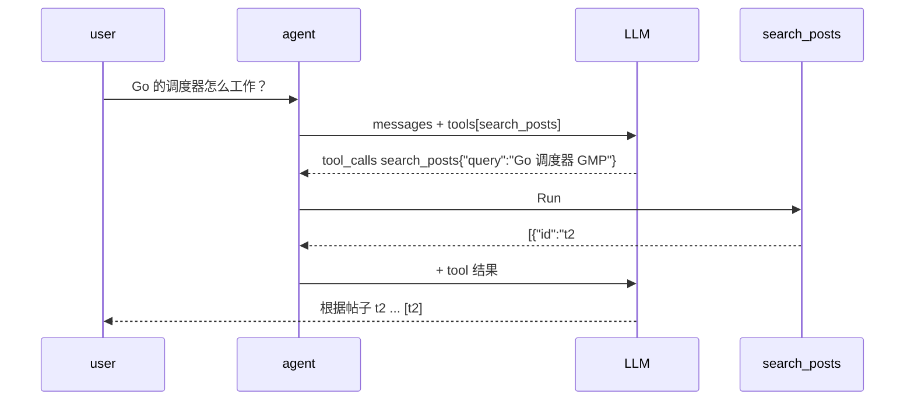

# ex04 把检索做成工具 search_posts（Medium）

## 题目
"每次都先检索再回答"（naive RAG）会在闲聊时浪费 token，也会把不相关片段塞进上下文。
现代做法是 **Agentic RAG**：把检索做成一个工具，让模型自己决定何时检索、检索什么词。

## 接口
```go
type SearchPosts struct { Embedder; Index Searcher; DefaultK, MaxK int }
func (s *SearchPosts) Def() common.Tool
func (s *SearchPosts) Run(ctx context.Context, argsJSON string) (string, error)
```
它满足 stage1 ex01 的 `Tool` 接口，可以直接 Register 进 Registry。

## 要求
- Schema：`query`(string, required)、`top_k`(integer)。每个参数都要有 description——小模型很依赖它。
- top_k 缺省 DefaultK，封顶 MaxK（防止模型要 1000 条撑爆上下文）。
- 返回 JSON 数组字符串，空结果返回 `[]` 而不是 `null`（模型对 null 的理解不稳定）。

## 验收
`go test ./stage3_rag/ex04_search_tool/`

## 流程

