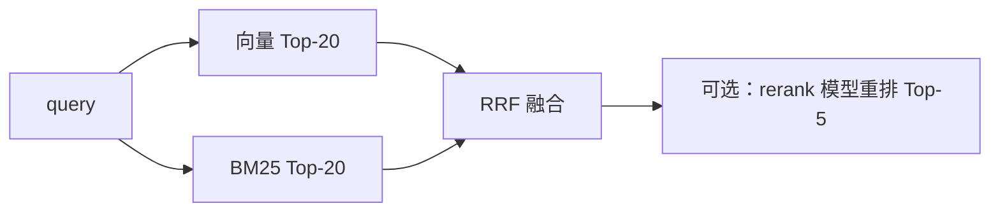

# ex05 混合检索：BM25 + 向量 + RRF 融合（Hard）

## 题目
向量检索擅长"意思相近"，但对专有名词、型号、错误码（`GMP`、`E1001`、帖子 tid）经常失手；
关键词检索（BM25）正好相反。生产 RAG 基本都是 **混合检索**：两路各取 Top-N，再融合。

## 接口
```go
func Tokenize(s string) []string
func NewBM25(docs []Doc) *BM25
func (b *BM25) Search(query string, k int) []Ranked
func RRF(lists [][]string, k int) []Ranked
```

## BM25 公式
```
idf(t) = ln(1 + (N - df(t) + 0.5) / (df(t) + 0.5))
score(d, q) = Σ_{t∈q} idf(t) · tf(t,d)·(k1+1) / ( tf(t,d) + k1·(1 - b + b·|d|/avgdl) )
k1 = 1.2, b = 0.75
```
- tf 高 → 分高，但会饱和（k1 控制）；文档长 → 惩罚（b 控制）。

## RRF
`score(id) = Σ_lists 1 / (k + rank)`，rank 从 1 开始，k 通常取 60。
优点：不需要把 BM25 分数和余弦分数归一化到同一尺度——只用名次。



## 验收
`go test ./stage3_rag/ex05_hybrid_rrf/`

## 关于中文分词
这里按单字切，是最简单的中文 BM25 做法（效果其实不差）。生产可用 jieba 或 n-gram。
