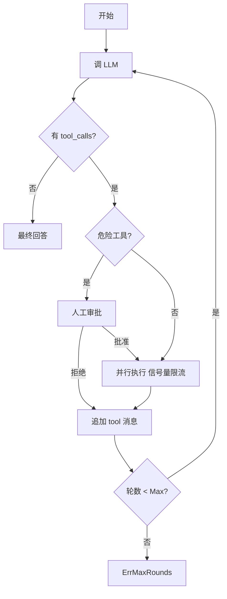
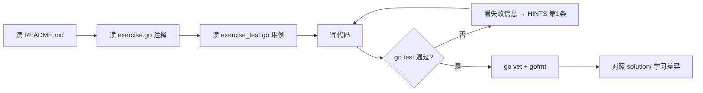

# 阶段 4：Agent 核心模式

> 建议用时：7~10 天　|　练习数：5　|　对应真实项目：server/agent（主循环）、server/tools

## 学完你能做到

- [ ] 手写 ReAct 循环（思考 → 工具 → 观察 → 再思考）和 Plan-and-Execute
- [ ] 让模型输出结构化 JSON，并用 Schema 校验 + 失败重试
- [ ] 并发执行多个工具调用，并控制并发度
- [ ] 危险操作前加人工审批（Human-in-the-loop）
- [ ] 把 prompt 模板化，并给工具描述做体检

## 全景图



## 核心概念

### 1. ReAct 循环
Agent 的本质就是一个 `for` 循环：调模型 → 有 tool_calls 就执行并追加结果 → 没有就结束。**一定要有最大轮数**，小模型会陷入"反复调同一个工具"的死循环。

### 2. Plan-and-Execute
先让模型输出计划（编号步骤），再逐步执行。优点：可审阅、可中断；缺点：计划可能和实际脱节。小模型上往往比 ReAct 稳定。

### 3. 结构化输出
小模型输出 JSON 常见问题：包在 ```json 代码块里、前面有一句废话、缺字段、类型错。对策：
1. 提取（ExtractJSON）
2. 校验（Validate，错误带路径如 `$.items[0].price`）
3. 把错误回喂给模型重试（AskStructured）

### 4. 并行工具
模型一次返回多个 tool_calls 时可以并发执行，但：结果顺序要和调用顺序一致；用信号量限制并发；单个失败不能拖垮全部。

### 5. 审批闸门
删除、发消息、付款这类**不可逆**操作，执行前必须问人。审批请求要有唯一 id、超时、拒绝理由要反馈给模型。

## 练习清单

| # | 目录 | 题目 | 完成 |
|---|---|---|---|
| 1 | [`ex01_react_loop`](./ex01_react_loop/) | ex01 ReAct 循环 与 Plan-and-Execute（Medium） | ☐ |
| 2 | [`ex02_json_schema`](./ex02_json_schema/) | ex02 结构化输出与 JSON Schema 校验（Hard） | ☐ |
| 3 | [`ex03_parallel_tools`](./ex03_parallel_tools/) | ex03 并行工具调用（Medium） | ☐ |
| 4 | [`ex04_approval_gate`](./ex04_approval_gate/) | ex04 人工审批闸门 Human-in-the-loop（Medium） | ☐ |
| 5 | [`ex05_prompt_template`](./ex05_prompt_template/) | ex05 Prompt 模板与工具描述体检（Easy） | ☐ |

## 每道题的做法



命令（在仓库根目录下）：

```bash
go test ./stage4_agent_patterns/ex01_react_loop/            # 测你的代码
go test ./stage4_agent_patterns/ex02_json_schema/            # 测你的代码
go test ./stage4_agent_patterns/ex03_parallel_tools/            # 测你的代码
go test ./stage4_agent_patterns/ex04_approval_gate/            # 测你的代码
go test ./stage4_agent_patterns/ex05_prompt_template/            # 测你的代码
go test -tags solution ./stage4_agent_patterns/...   # 看参考答案是否通过
go test -run TestXxx -v ./<目录>/      # 只跑某个用例并看详细输出
```

## 常见坑

1. 没有最大轮数 → 死循环烧钱。
2. 并发结果用 append 收集 → 顺序乱、还有数据竞争；用预分配切片按下标写。
3. `go test -race` 跑一遍并发练习。
4. 审批 channel 没人读就会永久阻塞——所有等待都要配 ctx 或超时。
5. 工具描述太短（"get post"）是小模型选错工具的头号原因。
6. Schema 重试要把**具体错误**告诉模型，只说"格式错了"没用。

## 自测问题（不看代码能回答出来才算掌握）

- **ex01 ReAct 循环 与 Plan-and-Execute（Medium）**：这道题解决了真实 Agent 里的什么问题？如果不做会出什么事故？
- **ex02 结构化输出与 JSON Schema 校验（Hard）**：这道题解决了真实 Agent 里的什么问题？如果不做会出什么事故？
- **ex03 并行工具调用（Medium）**：这道题解决了真实 Agent 里的什么问题？如果不做会出什么事故？
- **ex04 人工审批闸门 Human-in-the-loop（Medium）**：这道题解决了真实 Agent 里的什么问题？如果不做会出什么事故？
- **ex05 Prompt 模板与工具描述体检（Easy）**：这道题解决了真实 Agent 里的什么问题？如果不做会出什么事故？
- 本阶段哪一个知识点最容易在 你的 Agent 项目 里落地？写下你打算改哪个文件。

## 卡住时：给本地 LLM 的提问模板

> ⚠️ 本地小模型，**会犯错、会编 API**。它的答案只是线索，`go test` 的结果才是真相。

**解释概念**
```
你是 Go 和 LLM Agent 方面的老师。用中文、举一个 20 行以内的 Go 例子，解释：<概念>。
不要使用第三方库。
```

**看不懂测试失败**
```
这是一个 Go 练习。题目要求：
<粘贴 exercise.go 里的注释>
我的代码：
<粘贴你的函数>
go test 输出：
<粘贴失败信息>
请只指出哪一行逻辑有问题以及原因，不要直接给完整答案。
```

**代码审查**
```
请审查下面的 Go 代码，只关注：边界条件、并发安全、错误处理。列出问题，每条一句话。
<代码>
```

## 学习笔记

在这里记下你的心得（这个文件是你的，随便改）：

1. 
2. 
3. 
4. 
5. 
6. 
7. 
8. 
9. 
10. 
11. 
12. 
13. 
14. 
15. 
16. 
17. 
18. 
19. 
20. 
21. 
22. 

## 完成标准

- [ ] `go test ./stage4_agent_patterns/...` 全部 ok
- [ ] `go vet ./stage4_agent_patterns/...` 无输出
- [ ] `gofmt -l stage4_agent_patterns` 无输出
- [ ] 每道题都对照过 solution/，记下至少一个"原来还可以这样写"
- [ ] 回答完上面的自测问题

下一步：回到 [课程首页](../README.md) 勾选进度。
