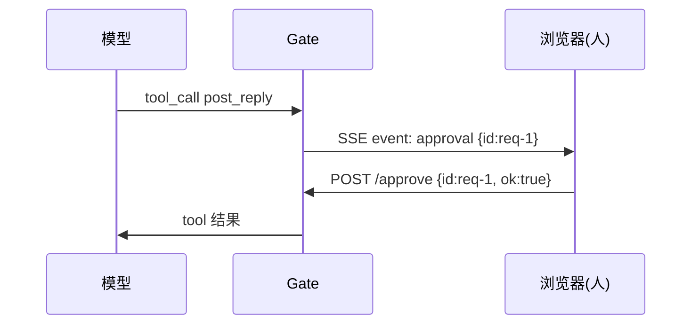

# ex04 人工审批闸门 Human-in-the-loop（Medium）

## 题目
读论坛是安全的，**发帖、删帖**不是。让 Agent 在执行危险工具前停下来等人点"同意"。

## 接口
见 exercise.go：`Gate`（装饰器模式包装 ToolRunner）、`ChanApprover`（channel 实现的审批队列）。

## 坑
- 等待审批必须尊重 ctx：用户关掉页面后 goroutine 不能永远挂着。
- Resolve 和超时可能同时发生：answer channel 带 1 个缓冲，Resolve 不会阻塞。
- 被拒绝时把 ErrDenied 作为工具错误回填给模型（ex01 的 "error: ..."），模型会向用户解释。

## 进阶（自选）
把 ChanApprover 接到 你的 Agent 项目：SSE 推 `approval` 事件，加 `POST /api/approve`。

## 验收
`go test ./stage4_agent_patterns/ex04_approval_gate/`
