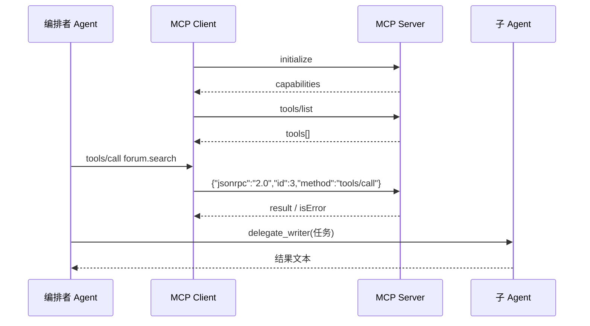
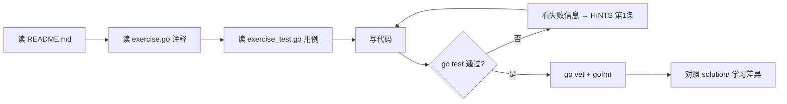

# 阶段 5：MCP 与多 Agent

> 建议用时：7~10 天　|　练习数：4　|　对应真实项目：未来的 server/mcp；你的 Agent 项目 的工具可以直接作为 MCP Server 给 Cursor 用

## 学完你能做到

- [ ] 读懂并手写 MCP（Model Context Protocol）的 JSON-RPC 消息
- [ ] 写一个 stdio MCP Server 暴露工具
- [ ] 写一个 MCP Client 并把远端工具转换成本地 tools 定义
- [ ] 用"委派即工具"实现子 Agent / 编排者
- [ ] 用关键词 + LLM 分类做意图路由

## 全景图



## 核心概念

### 1. MCP 是什么
MCP 是"工具的 USB 接口"：任何 MCP Server 暴露的工具，任何 MCP Client（Claude Desktop、Cursor、你的 你的 Agent 项目）都能用。底层是 **JSON-RPC 2.0**，传输可以是 stdio（一行一个 JSON）或 HTTP。

### 2. 关键消息
| method | 作用 |
|---|---|
| `initialize` | 握手，交换 protocolVersion 和能力 |
| `tools/list` | 列出工具（name / description / inputSchema） |
| `tools/call` | 调用工具，返回 `content[]` 和 `isError` |
| `ping` | 心跳 |

### 3. 两种错误不要混
- **RPC 错误**（`error` 字段）：协议层问题——方法不存在、参数解析失败。
- **工具错误**（`result.isError=true`）：工具执行失败，内容要给模型看，让它修正。

### 4. 多 Agent
- 子 Agent = 有自己 system prompt 和工具集的 Agent。
- 编排者把每个子 Agent 包装成一个工具 `delegate_<name>`，模型"调用工具"就是委派任务。
- 路由：先用便宜的关键词规则，匹配不上再问 LLM 分类，最后默认兜底。

## 练习清单

| # | 目录 | 题目 | 完成 |
|---|---|---|---|
| 1 | [`ex01_mcp_server`](./ex01_mcp_server/) | ex01 手写 MCP Server（Hard） | ☐ |
| 2 | [`ex02_mcp_client`](./ex02_mcp_client/) | ex02 MCP Client（Medium） | ☐ |
| 3 | [`ex03_subagent`](./ex03_subagent/) | ex03 子 Agent 与"委派即工具"（Medium） | ☐ |
| 4 | [`ex04_router`](./ex04_router/) | ex04 意图路由：关键词 + LLM 分类兜底（Easy） | ☐ |

## 每道题的做法



命令（在仓库根目录下）：

```bash
go test ./stage5_mcp_multiagent/ex01_mcp_server/            # 测你的代码
go test ./stage5_mcp_multiagent/ex02_mcp_client/            # 测你的代码
go test ./stage5_mcp_multiagent/ex03_subagent/            # 测你的代码
go test ./stage5_mcp_multiagent/ex04_router/            # 测你的代码
go test -tags solution ./stage5_mcp_multiagent/...   # 看参考答案是否通过
go test -run TestXxx -v ./<目录>/      # 只跑某个用例并看详细输出
```

## 常见坑

1. JSON-RPC 的 id 可能是数字也可能是字符串，用 `json.RawMessage` 原样回传。
2. notification（没有 id）不要回复。
3. 解析失败时响应的 id 必须是 `null`。
4. stdio 模式下**任何日志都不能写 stdout**，会污染协议；写 stderr。
5. 子 Agent 也要有最大轮数，否则一层套一层地爆炸。
6. 路由要记录走的是哪条路（keyword / llm / default），方便调规则。

## 自测问题（不看代码能回答出来才算掌握）

- **ex01 手写 MCP Server（Hard）**：这道题解决了真实 Agent 里的什么问题？如果不做会出什么事故？
- **ex02 MCP Client（Medium）**：这道题解决了真实 Agent 里的什么问题？如果不做会出什么事故？
- **ex03 子 Agent 与"委派即工具"（Medium）**：这道题解决了真实 Agent 里的什么问题？如果不做会出什么事故？
- **ex04 意图路由：关键词 + LLM 分类兜底（Easy）**：这道题解决了真实 Agent 里的什么问题？如果不做会出什么事故？
- 本阶段哪一个知识点最容易在 你的 Agent 项目 里落地？写下你打算改哪个文件。

## 卡住时：给本地 LLM 的提问模板

> ⚠️ 本地小模型，**会犯错、会编 API**。它的答案只是线索，`go test` 的结果才是真相。

**解释概念**
```
你是 Go 和 LLM Agent 方面的老师。用中文、举一个 20 行以内的 Go 例子，解释：<概念>。
不要使用第三方库。
```

**看不懂测试失败**
```
这是一个 Go 练习。题目要求：
<粘贴 exercise.go 里的注释>
我的代码：
<粘贴你的函数>
go test 输出：
<粘贴失败信息>
请只指出哪一行逻辑有问题以及原因，不要直接给完整答案。
```

**代码审查**
```
请审查下面的 Go 代码，只关注：边界条件、并发安全、错误处理。列出问题，每条一句话。
<代码>
```

## 学习笔记

在这里记下你的心得（这个文件是你的，随便改）：

1. 
2. 
3. 
4. 
5. 
6. 
7. 
8. 
9. 
10. 
11. 
12. 
13. 
14. 
15. 
16. 
17. 
18. 
19. 
20. 
21. 
22. 

## 完成标准

- [ ] `go test ./stage5_mcp_multiagent/...` 全部 ok
- [ ] `go vet ./stage5_mcp_multiagent/...` 无输出
- [ ] `gofmt -l stage5_mcp_multiagent` 无输出
- [ ] 每道题都对照过 solution/，记下至少一个"原来还可以这样写"
- [ ] 回答完上面的自测问题

下一步：回到 [课程首页](../README.md) 勾选进度。
