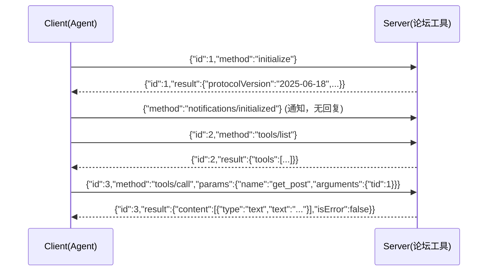

# ex01 手写 MCP Server（Hard）

## 题目
MCP（Model Context Protocol）让"工具"变成独立进程，任何 Agent（Claude Desktop、Cursor、你的 你的 Agent 项目）都能复用。
传输层最简单的是 **stdio**：每行一个 JSON-RPC 2.0 消息。

## 关键区分
| 情况 | 返回 |
|---|---|
| 工具执行失败（参数错、论坛 500） | **result**，`isError: true`——让模型看到错误 |
| 协议层错误（未知方法、未知工具、JSON 坏了） | **error**，带 JSON-RPC 错误码 |

## 坑
- id 可以是数字也可以是字符串，原样回显：用 `json.RawMessage` 保存。
- 通知没有 id，**绝对不能回复**，否则客户端会乱。
- stdout 只能写协议消息！日志要写 stderr，否则会污染协议流（真实开发中最常见的 bug）。
- bufio.Scanner 默认单行上限 64KB，长工具结果要调大 Buffer。

## 验收
`go test ./stage5_mcp_multiagent/ex01_mcp_server/`

## 进阶
写一个 `cmd/forum-mcp/main.go`：`s.Serve(ctx, os.Stdin, os.Stdout)`，把 你的 Agent 项目 的 get_list/get_post 注册进去。
