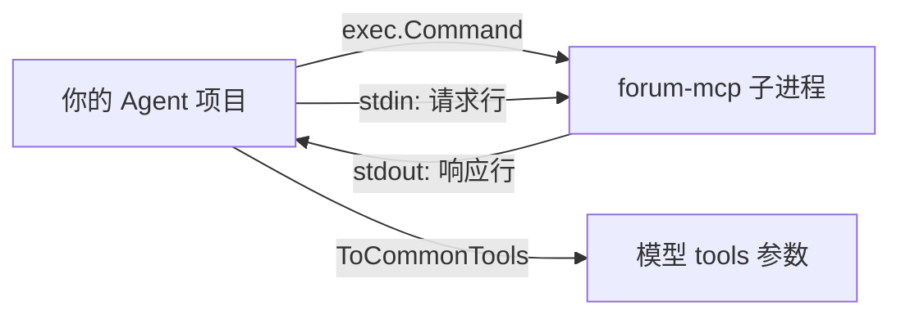

# ex02 MCP Client（Medium）

## 题目
上一题写了服务器，这一题写客户端：Agent 启动 MCP 服务器子进程，通过它的 stdin/stdout 通信，
把服务器的工具"接"进自己的工具列表。



真实使用（练习之外）：
```go
cmd := exec.Command("./forum-mcp")
stdin, _ := cmd.StdinPipe()
stdout, _ := cmd.StdoutPipe()
cmd.Start()
c := NewClient(stdout, stdin)
```
测试用 `io.Pipe` 模拟，不启动进程。

## 要求
见 exercise.go。注意三种响应：正常 result、`isError: true` 的 result（→ ToolError）、JSON-RPC error（→ RPCError）。

## 坑
- 服务器可能在响应之前插入通知（日志、进度），要按 id 匹配。
- 并发调用同一个 stdio 连接要加锁（本题用一把互斥锁串行化最简单）。
- Client 实现了 `common.ToolRunner`，所以可以直接塞进 stage4 的 Agent——这就是 MCP 的价值。

## 验收
`go test ./stage5_mcp_multiagent/ex02_mcp_client/`
