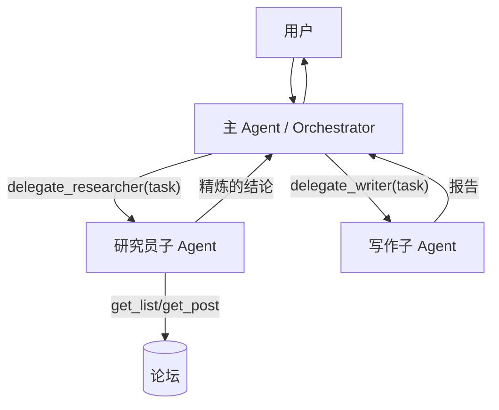

# ex03 子 Agent 与"委派即工具"（Medium）

## 题目
多 Agent 最实用的形态：**主 Agent 把子 Agent 当成工具调用**。
子 Agent 有独立 system prompt、独立工具、**独立上下文**——主 Agent 的上下文不会被子任务的大量工具输出撑爆。

## 要求
见 exercise.go。

## 讨论
- 子 Agent 只返回**结论**，原始帖子留在它自己的上下文里——这就是"上下文隔离"。
- 缺点：多一层模型调用，延迟和费用翻倍；子 Agent 看不到主对话，task 必须写完整（所以参数描述写"完整任务描述"）。
- 小模型（本地小模型）做主 Agent 时委派常常失误，用 stage6 的评测去量化。

## 验收
`go test ./stage5_mcp_multiagent/ex03_subagent/`
