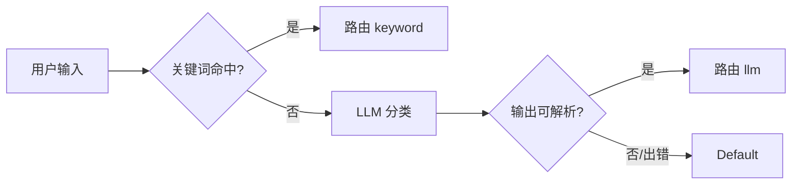

# ex04 意图路由：关键词 + LLM 分类兜底（Easy）

## 题目
不是每个请求都需要大 Agent。先**便宜地**判断意图，再分发：

## 要求
见 exercise.go。来源字段（keyword/llm/default）方便你统计每种路径的比例。

## 小模型输出的真实样子
你会看到 `Forum。`、`` `code` ``、`类别：forum`、`我认为是 forum`……
所以解析要宽容，但**有歧义时要保守**（回落到 Default）。

## 验收
`go test ./stage5_mcp_multiagent/ex04_router/`
