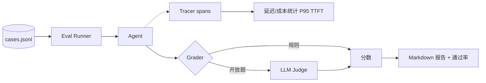
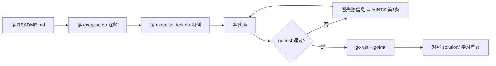

# 阶段 6：可观测性与评测

> 建议用时：5~7 天　|　练习数：4　|　对应真实项目：server 的日志/指标；docs 里的评测报告

## 学完你能做到

- [ ] 给一次 Agent 请求画出 Trace 调用树
- [ ] 建立评测集（JSONL）并批量跑分
- [ ] 用 LLM-as-Judge 评估开放式回答，并计算与人工标注的一致率
- [ ] 统计 TTFT、P95 延迟、token 成本

## 全景图



## 核心概念

### 1. 没有评测就没有优化
改了 prompt 感觉"好像好了"不算数。**评测集 + 自动跑批**让每次修改都有数字对比。从 20 条真实问题开始就够了。

### 2. 评分方式
| 方式 | 适合 | 成本 |
|---|---|---|
| 精确匹配 / 包含关键词 | 有标准答案 | 免费 |
| 工具调用检查 | 是否调了正确工具 | 免费 |
| LLM-as-Judge | 开放式回答 | 花 token、会有偏差 |

Judge 要和人工标注对比**一致率**，低于 80% 就别信它。

### 3. Trace
一次请求 = 一棵 span 树：`agent.run` → `llm.complete` → `tool.search_posts`……每个 span 记录开始、结束、属性、错误。出问题时一眼看出慢在哪、错在哪。

### 4. 延迟指标
- **TTFT**（首 token 时间）：用户感知的"卡不卡"。
- **总时长 / tokens 每秒**：生成速度。
- **P95**：别只看平均，长尾才是用户投诉的来源。

## 练习清单

| # | 目录 | 题目 | 完成 |
|---|---|---|---|
| 1 | [`ex01_trace`](./ex01_trace/) | ex01 Trace：给 Agent 一次请求画出调用树（Easy） | ☐ |
| 2 | [`ex02_eval_runner`](./ex02_eval_runner/) | ex02 评测集与评测跑批（Medium） | ☐ |
| 3 | [`ex03_llm_judge`](./ex03_llm_judge/) | ex03 LLM-as-Judge（Medium） | ☐ |
| 4 | [`ex04_cost_latency`](./ex04_cost_latency/) | ex04 延迟与成本：TTFT、P95、tokens/s（Easy） | ☐ |

## 每道题的做法



命令（在仓库根目录下）：

```bash
go test ./stage6_observability_eval/ex01_trace/            # 测你的代码
go test ./stage6_observability_eval/ex02_eval_runner/            # 测你的代码
go test ./stage6_observability_eval/ex03_llm_judge/            # 测你的代码
go test ./stage6_observability_eval/ex04_cost_latency/            # 测你的代码
go test -tags solution ./stage6_observability_eval/...   # 看参考答案是否通过
go test -run TestXxx -v ./<目录>/      # 只跑某个用例并看详细输出
```

## 常见坑

1. 评测时用真实时钟 → 测试不稳定；注入 Clock。
2. Judge 输出解析失败要重试一次，仍失败记为"无法判定"而不是通过。
3. Judge 和被测模型是同一个模型时会自我偏袒。
4. P95 用 nearest-rank 还是插值要统一，不然和别的工具对不上。
5. 评测集要版本化，改了用例要能看出来。

## 自测问题（不看代码能回答出来才算掌握）

- **ex01 Trace：给 Agent 一次请求画出调用树（Easy）**：这道题解决了真实 Agent 里的什么问题？如果不做会出什么事故？
- **ex02 评测集与评测跑批（Medium）**：这道题解决了真实 Agent 里的什么问题？如果不做会出什么事故？
- **ex03 LLM-as-Judge（Medium）**：这道题解决了真实 Agent 里的什么问题？如果不做会出什么事故？
- **ex04 延迟与成本：TTFT、P95、tokens/s（Easy）**：这道题解决了真实 Agent 里的什么问题？如果不做会出什么事故？
- 本阶段哪一个知识点最容易在 你的 Agent 项目 里落地？写下你打算改哪个文件。

## 卡住时：给本地 LLM 的提问模板

> ⚠️ 本地小模型，**会犯错、会编 API**。它的答案只是线索，`go test` 的结果才是真相。

**解释概念**
```
你是 Go 和 LLM Agent 方面的老师。用中文、举一个 20 行以内的 Go 例子，解释：<概念>。
不要使用第三方库。
```

**看不懂测试失败**
```
这是一个 Go 练习。题目要求：
<粘贴 exercise.go 里的注释>
我的代码：
<粘贴你的函数>
go test 输出：
<粘贴失败信息>
请只指出哪一行逻辑有问题以及原因，不要直接给完整答案。
```

**代码审查**
```
请审查下面的 Go 代码，只关注：边界条件、并发安全、错误处理。列出问题，每条一句话。
<代码>
```

## 学习笔记

在这里记下你的心得（这个文件是你的，随便改）：

1. 
2. 
3. 
4. 
5. 
6. 
7. 
8. 
9. 
10. 
11. 
12. 
13. 
14. 
15. 
16. 
17. 
18. 
19. 
20. 
21. 
22. 

## 完成标准

- [ ] `go test ./stage6_observability_eval/...` 全部 ok
- [ ] `go vet ./stage6_observability_eval/...` 无输出
- [ ] `gofmt -l stage6_observability_eval` 无输出
- [ ] 每道题都对照过 solution/，记下至少一个"原来还可以这样写"
- [ ] 回答完上面的自测问题

下一步：回到 [课程首页](../README.md) 勾选进度。
