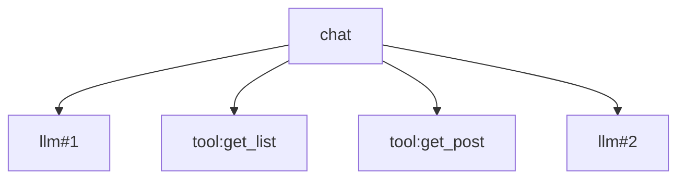

# ex01 Trace：给 Agent 一次请求画出调用树（Easy）

## 为什么
Agent 慢、贵、答错的时候，你需要回答：**哪一轮 LLM 慢？调了几次工具？哪个工具报错？**
日志是平的，trace 是树：

```
chat 4210ms session=abc
  llm#1 1800ms model=glm-4 tokens=812
  tool:get_list 120ms
  tool:get_post 95ms
  llm#2 2150ms
```



## 要求
见 exercise.go。Clock 接口让测试可确定（不要在实现里直接用 `time.Now()`）。

## 和 OpenTelemetry 的关系
这就是 OTel 的 Span 模型的极简版（trace_id / span_id / parent_id 省略成指针）。
旅行回来后可以把它换成 `go.opentelemetry.io/otel`，概念完全一致。

## 进阶
在 你的 Agent 项目 的 runOneRound 里，每轮开一个 `llm#N` span，每个工具调用开一个 `tool:<name>` span，请求结束时把 Render() 打到 slog。

## 验收
`go test ./stage6_observability_eval/ex01_trace/`
