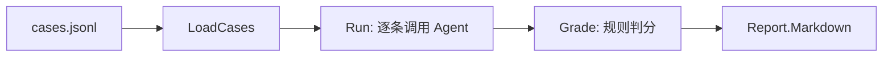

# ex02 评测集与评测跑批（Medium）

## 为什么
改了 prompt、换了模型、加了工具——**变好了还是变坏了？** 没有评测集就只能凭感觉。
Agent 工程师的核心习惯：**每次改动都跑一遍评测，看通过率。**

## 规则判分 vs LLM 判分
| | 规则（本题） | LLM 裁判（下一题） |
|---|---|---|
| 成本 | 0 | 每条一次调用 |
| 稳定性 | 100% 可复现 | 有波动 |
| 能判断 | 关键词、是否调了工具、是否泄漏 | 语义正确性、完整性、语气 |
实践中两者结合：规则先过滤，LLM 判剩下的。

## 要求
见 exercise.go。`testdata/cases.jsonl` 是一份示例评测集，你可以继续往里加。

## 进阶
写 `cmd/eval/main.go`：真正连 本地 LLM 跑你的 你的 Agent 项目，把 Markdown 报告存成 `eval-日期.md`，对比不同 prompt 的通过率。

## 验收
`go test ./stage6_observability_eval/ex02_eval_runner/`
