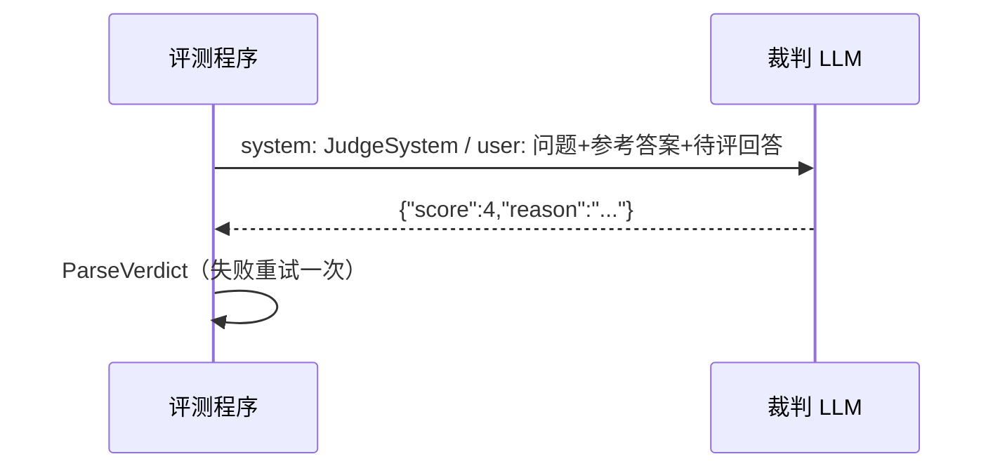

# ex03 LLM-as-Judge（Medium）

## 题目
规则判不了"回答对不对、全不全"。让另一个 LLM 当裁判打分。

## 要求
见 exercise.go。

## 裁判也会错 —— 一定要校准
1. 自己人工给 20 条回答打分。
2. 用 Judge 打同样 20 条。
3. `Agreement(人工, 裁判, 1)` ≥ 0.8 才可以信任这个裁判。
小模型当裁判的常见毛病：**偏爱长回答**、**偏爱和自己风格相似的回答**、给分集中在 4。
可以试着在 JudgeSystem 里加"长度不是加分项"，再测一次一致率。

## 验收
`go test ./stage6_observability_eval/ex03_llm_judge/`
