# ex04 延迟与成本：TTFT、P95、tokens/s（Easy）

## 指标

```mermaid
gantt
  dateFormat x
  axisFormat %L ms
  section 一次 LLM 调用
  等待首 token (TTFT) :0, 400
  生成 (tokens/s)      :400, 2400
```

- **TTFT**（Time To First Token）：用户感觉"卡不卡"的关键，流式输出就是为了降它。
- **Total**：总耗时。Agent 一次请求可能包含多轮 LLM，要逐轮记录。
- **P50 / P95**：平均值会骗人，看分位数。P95 = 最慢的 5% 有多慢。
- **tokens/s**：生成速度，衡量模型/硬件。
- **Cost**：按 usage 的 prompt/completion token 计价。

## 要求
见 exercise.go。Percentile 用 nearest-rank：排序后取第 ⌈p·n/100⌉ 个。

## 进阶
在 common.Client 的流式循环里记录收到第一个 delta 的时间，就能得到真实 TTFT。
用 本地 LLM 跑 20 次同一个问题，算出 P50/P95 TTFT，写进笔记——这是你面试时能讲的真实数据。

## 验收
`go test ./stage6_observability_eval/ex04_cost_latency/`
