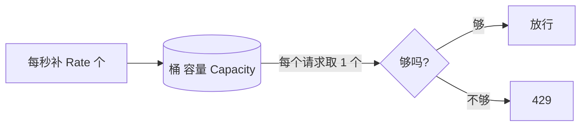

# ex02 限流与每日额度（Medium）

## 为什么
LLM 很贵、上游有 QPS 限制、一个死循环的前端能把你一天的额度烧光。
上线前必须有：**每用户限流** + **每日 token 额度**。

## 令牌桶

- 允许突发（桶满时可以连发 Capacity 个），长期速率被限制在 Rate。
- 不需要定时器：每次请求时按"距上次经过的时间 × Rate"懒补充。

## 要求
见 exercise.go。全部依赖 Clock 接口，测试可确定。

## 坑
- 补充后要 cap 到容量，否则闲置一晚上就能突发上万请求。
- map + 并发 = 必须加锁（试试 `go test -race`）。
- 每日额度按 **UTC** 还是本地时间换日？要和产品约定清楚，本题用 UTC。
- 生产中用户量大时 map 会无限增长，需要定期清理长期不活跃的 key（本题不要求）。

## 验收
`go test ./stage7_production/ex02_rate_limiter/`
