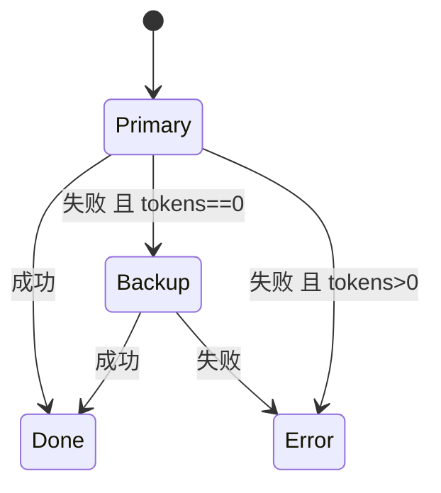

# ex03 SSE 心跳与模型降级（Medium）

## 三个生产问题
1. **SSE 格式**：多行 data 必须拆成多个 `data:` 行，否则前端解析错乱。
2. **空闲断连**：模型"思考"30 秒没输出，nginx 默认 60s 超时、某些代理更短 → 连接被掐断。解决：定期发 SSE 注释行 `: ping`（浏览器 EventSource 会忽略注释）。
3. **上游故障**：主模型挂了自动切备用模型——但只能在**还没输出任何 token** 时切。

## 要求
见 exercise.go。

## 坑
- 心跳 goroutine 和正文写入同一个 `http.ResponseWriter`，**必须加锁**，否则字节交错。写完记得 `Flush()`（本题省略）。
- 心跳用 `time.NewTicker(15*time.Second).C` 作为 ticks 传入；本题传入 channel 让测试不依赖真实时间。
- 降级要记录在日志/trace 里（用了哪个模型），否则排查时一头雾水。

## 验收
`go test ./stage7_production/ex03_sse_heartbeat_fallback/`
