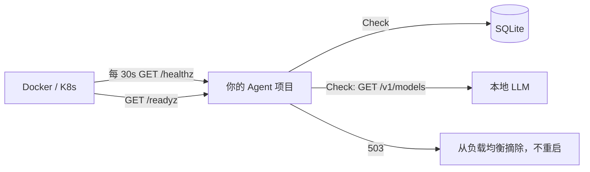

# ex04 部署：健康检查、配置校验、Dockerfile（Medium）

## 题目
上线 checklist 的三件事：
1. **探针**：`/healthz`（存活：进程活着吗）和 `/readyz`（就绪：依赖都可用吗，能接流量吗）。
2. **配置**：启动时就校验环境变量，配错立刻退出，而不是第一个请求时才炸。
3. **镜像**：多阶段构建、健康检查、非 root。

## 要求
1. 实现 exercise.go 里的函数。
2. **修改本目录的 `Dockerfile`**，让 `TestYourDockerfile` 通过（它用你的 CheckDockerfile 检查你的 Dockerfile）。

## 坑
- 存活探针不要检查依赖：LLM 挂了 → 存活失败 → 容器被重启 → 重启也没用 → 无限重启。
- 就绪检查一定要有超时，否则一个卡住的依赖让探针本身超时。
- distroless 镜像里没有 wget/curl，HEALTHCHECK 要么换 alpine，要么让二进制自带 `server -healthcheck` 子命令。
- 本课程离线：vendor 目录要 COPY 进镜像并用 `-mod=vendor` 构建。

## 验收
`go test ./stage7_production/ex04_deploy_health/`

## 进阶
给 你的 Agent 项目 真正加上这两个探针和 LoadConfig，写 docker-compose.yml。
